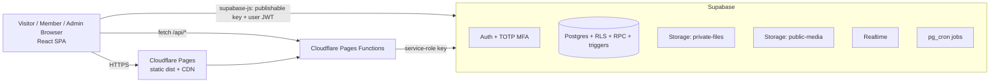
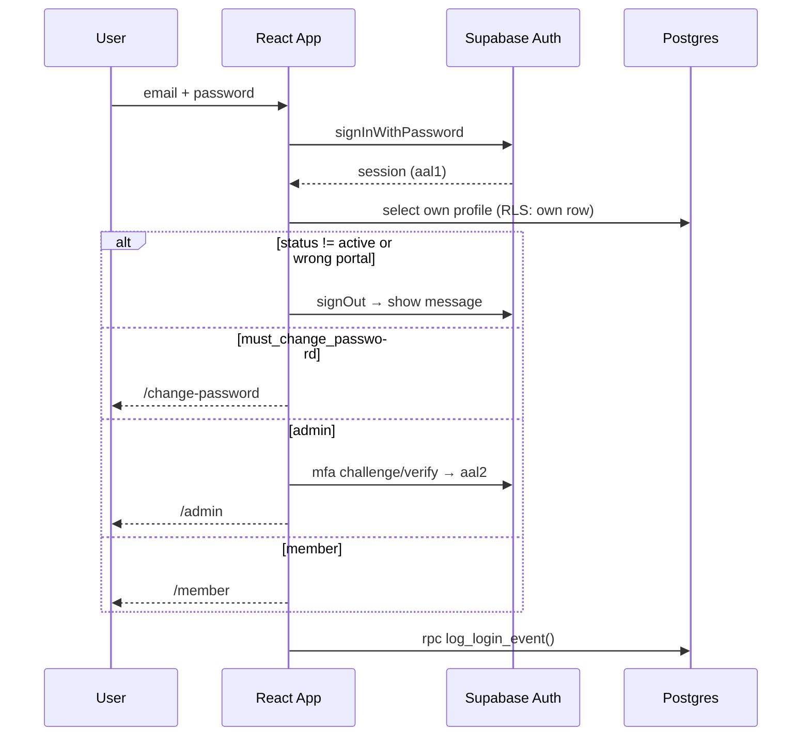
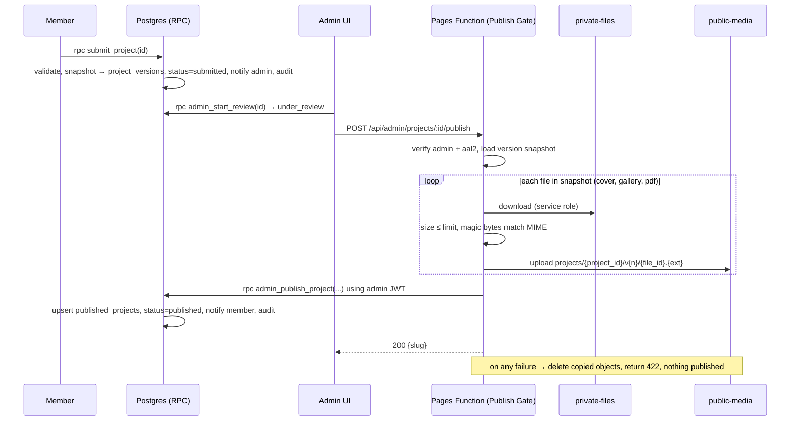
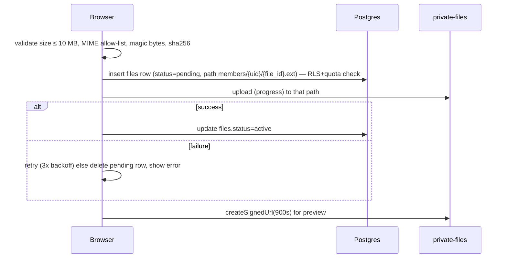
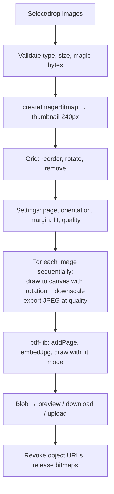

# 02 — Technical Requirements Document (TRD)

**Product:** Inspire Team · **Version:** 1.0 · **Date:** 12 Nov 2026
Related: `01_PRD.md` (requirement IDs) · `05_Backend_Schema.md` (tables/RPC/RLS) · `03_App_Flow.md` (routes) · `06_Implementation_Plan.md`

---

## 1. Technical Principles

1. Browser is **untrusted**. Every privilege is enforced by Supabase RLS, `SECURITY DEFINER` RPCs, Storage policies, or Cloudflare Pages Functions — never only by UI checks.
2. Public and private data live in **different tables/buckets**; public pages read only published snapshots.
3. No secrets in the repo or client bundle. Only publishable (anon) key is client-side.
4. No fake production behaviour. Demo Mode exists only for dev preview (§23).
5. One data-access layer (`src/services/*`); components never call Supabase directly.

## 2. Technology Stack

| Layer | Choice | Notes |
|---|---|---|
| Build tool | Vite + React 18 + TypeScript (strict) | `npm run build` → `dist` |
| Routing | `react-router-dom` v6 (BrowserRouter) | SPA fallback via `public/_redirects` |
| Styling | Tailwind CSS compiled by Vite (**not** CDN script) + CSS-variable tokens | logical properties for RTL |
| Data fetching | `@tanstack/react-query` | caching, pagination |
| Forms/validation | `react-hook-form` + `zod` | schemas shared with services |
| i18n | `i18next` + `react-i18next` | `en`, `ur` |
| Icons (functional UI) | `lucide-react` | decorative/brand images arrive later via the Images workflow |
| Charts | `recharts` (admin only, lazy-loaded) | |
| PDF generation | `pdf-lib` (lazy-loaded on PDF tool route) | see §13 |
| Reorder | `@dnd-kit/core` + `@dnd-kit/sortable` + keyboard buttons | |
| Markdown | `react-markdown` (no raw HTML) | |
| Backend | Supabase: Postgres, Auth, Storage, Realtime, `pg_cron` | created later by ChatGPT |
| Server code | Cloudflare **Pages Functions** (`/functions`, TypeScript) | service-role operations, SEO, contact |
| Hosting | Cloudflare Pages (GitHub integration) | no Vercel |
| Source control | GitHub (AI Studio export → PR-only changes) | |

Pin exact versions in `package.json` (use stable versions available at build time). Keep `package-lock.json`; **no** `bun.lock`/`bun.lockb`; root `.npmrc` contains `legacy-peer-deps=true`; `.node-version` = `20`.

## 3. System Architecture



## 4. Trust Boundaries

| Component | Trusted? | Responsibilities |
|---|---|---|
| Browser (React) | ❌ | UI, validation for UX, client-side PDF generation, route guards (UX only) |
| Supabase Postgres (RLS/RPC/triggers) | ✅ | Authorization, state transitions, audit, notifications, derived status |
| Supabase Storage policies | ✅ | Private/public separation, per-path access |
| Cloudflare Pages Functions | ✅ | Operations needing service role: create member, reset password, change status, Publish Gate, contact intake, sitemap, SEO meta injection |
| Cloudflare CDN | ✅ | HTTPS, caching, headers |

## 5. Frontend Structure

```text
inspire-team/
├─ index.html
├─ package.json  package-lock.json  .npmrc  .node-version  vite.config.ts  tsconfig.json
├─ tailwind.config.ts  postcss.config.js
├─ public/  _redirects  _headers  robots.txt  favicon.svg
├─ functions/                      # Cloudflare Pages Functions (see §9.3)
│  ├─ _lib/ (auth.ts, supabase.ts, http.ts, validate.ts)
│  ├─ api/admin/members/index.ts            (POST)
│  ├─ api/admin/members/[id]/reset-password.ts   (POST)
│  ├─ api/admin/members/[id]/status.ts      (POST)
│  ├─ api/admin/projects/[id]/publish.ts    (POST)
│  ├─ api/contact.ts                        (POST)
│  ├─ sitemap.xml.ts                        (GET)
│  ├─ team/[slug].ts   projects/[slug].ts   (HTML meta injection)
├─ src/
│  ├─ main.tsx  App.tsx  routes.tsx
│  ├─ app/            providers (Query, Auth, Theme, I18n, Toast), error boundary
│  ├─ components/ui/  Button, Input, Select, Textarea, Checkbox, Switch, Badge, Card, Modal, ConfirmDialog, Tabs, Table, Pagination, Skeleton, EmptyState, ErrorState, Toast, Dropdown, Tooltip, FileDropzone, ImageSlot, StatusBadge
│  ├─ components/layout/  PublicLayout, AdminLayout, MemberLayout, Header, Footer, Sidebar, TopBar, LanguageSwitcher, ThemeToggle, NotificationBell
│  ├─ features/
│  │   auth/  public/  admin/{dashboard,members,assignments,reviews,files,taxonomy,content,messages,analytics,activity,settings,security,backup}/
│  │   member/{dashboard,profile,assignments,projects,submissions,files,notifications,settings}/
│  │   pdf-tool/  notifications/
│  ├─ services/       one file per domain (auth, members, assignments, projects, reviews, files, public, taxonomy, notifications, settings, content, audit, analytics, contact, exports) + services/demo/*
│  ├─ lib/            supabase.ts, env.ts, i18n.ts, url.ts (safeUrl), sanitize.ts, format.ts, errors.ts, upload.ts, magicBytes.ts, pdf/*
│  ├─ hooks/  types/  (generated DB types in types/database.ts)
│  ├─ locales/  en.json  ur.json
│  └─ styles/  globals.css (tokens), rtl.css (only if unavoidable)
└─ supabase/  (added later by ChatGPT: migrations/, config notes)
```

`src/lib/env.ts` is the **only** place reading `import.meta.env`. It validates required variables and decides production-config-error vs. Demo Mode.

## 6. Data-Access Rules

- Services return typed results `{ data, error }` mapped to app error codes (§20).
- Query keys: `['projects', scope, filters, page]`, `['assignment', id]`, etc.
- Public list queries select explicit columns; never `select('*')` on public tables.
- Pagination: `range()` (12/page public, 20/page admin); total via `count: 'exact'` only on first page.
- Mutations invalidate relevant keys; optimistic updates only for notification read-state.

## 7. Authentication Architecture

- Supabase Auth, email+password only. **Signups disabled**, email confirmation irrelevant (users created by Function with `email_confirm: true`).
- Two login pages share `signInWithPassword`; post-login `AuthProvider` loads `profiles` row and applies guards: `status = active`, role matches portal, `must_change_password`, admin AAL2.
- Admin MFA: TOTP via `supabase.auth.mfa.enroll/challenge/verify`; session must be `aal2` for admin routes; RLS admin policies include `aal2` check (`05_Backend_Schema.md` §3).
- Password reset: `resetPasswordForEmail` → `/reset-password` (needs SMTP, manual config). Admin-assisted reset via Function.
- Idle timeout implemented client-side (admin 30 min / member 8 h) → `signOut()`.



## 8. Authorization Architecture (defence in depth)

| Layer | Purpose |
|---|---|
| Route guards (`RequireAuth`, `RequireRole`, `RequireAAL2`, `RequirePasswordChanged`) | UX only |
| RLS policies | Row-level read/write rules per table |
| Guard triggers | Block members from changing protected columns |
| `SECURITY DEFINER` RPCs | All state transitions (submit, review, publish, assignment status) with internal permission checks |
| Pages Functions | Service-role operations after verifying caller is active admin with aal2 |
| Storage policies | Path-based access to buckets |

Function auth pattern (`functions/_lib/auth.ts`): read `Authorization: Bearer <jwt>` → `supabase.auth.getUser(jwt)` → load `profiles` (role=`admin`, status=`active`) → decode JWT payload to confirm `aal === 'aal2'` → else 401/403.

## 9. Backend Interfaces

### 9.1 PostgREST (supabase-js)
Standard CRUD under RLS for: categories, tags, projects (member drafts), files, assignment comments, notifications (read), site settings, etc. Exact policies in `05_Backend_Schema.md` §4.

### 9.2 RPC (database functions)
Member: `submit_project`, `withdraw_submission`, `start_project_revision`, `withdraw_project_revision`, `update_my_assignment`, `delete_my_file`, `mark_notifications_read`, `log_login_event`, `member_dashboard_stats`, `submit_profile_change_request`.
Admin: `admin_start_review`, `admin_publish_project`, `admin_request_changes`, `admin_reject_project`, `admin_unpublish_project`, `admin_republish_project`, `admin_archive_project`, `admin_restore_project`, `admin_set_featured`, `admin_add_internal_note`, `admin_review_profile_change`, `admin_complete_assignment`, `admin_cancel_assignment`, `admin_request_assignment_revision`, `admin_dashboard_stats`, `admin_storage_report`.
Public (anon-callable, read-only): `search_published_projects`, `search_published_members`.

### 9.3 Cloudflare Pages Functions

| Method | Path | Caller | Purpose | Validation / errors |
|---|---|---|---|---|
| POST | `/api/admin/members` | admin (aal2) | Create auth user + `profiles` + `member_profiles`; return temp password once | zod: email, full_name, slug (unique, regex), title; 400 invalid, 409 duplicate email/slug |
| POST | `/api/admin/members/:id/reset-password` | admin | Generate new temp password; set `must_change_password` | 404 unknown |
| POST | `/api/admin/members/:id/status` | admin | `{status}` active/suspended/deactivated; ban/unban auth user; hide public profile on suspend/deactivate | cannot change own status; cannot change another admin |
| POST | `/api/admin/projects/:id/publish` | admin | **Publish Gate** (§10): verify files, copy to `public-media`, then call RPC `admin_publish_project` with the admin's own JWT | 409 if status ≠ under_review; 422 if a file fails verification |
| POST | `/api/contact` | public | Intake contact form (honeypot, length limits, IP-hash rate limit, optional Turnstile) → insert `contact_submissions` + notify admin | 400 / 429 |
| GET | `/sitemap.xml` | public | Lists published members/projects/pages | cached 1 h |
| GET | `/team/:slug`, `/projects/:slug` | public | Serve SPA `index.html` with injected `<title>`, description, canonical, OG/Twitter tags, JSON-LD (via `HTMLRewriter`); unknown slug → normal SPA 404 view with `noindex` | |

Error response convention (Functions): `{ "error": { "code": "FORBIDDEN", "message": "…", "requestId": "…" } }`. Codes: `UNAUTHENTICATED` 401, `FORBIDDEN` 403, `NOT_FOUND` 404, `VALIDATION_FAILED` 400/422, `CONFLICT` 409, `RATE_LIMITED` 429, `INTERNAL` 500. Never leak stack traces.

Admin Function calls are not idempotent by nature; creating a member with an existing email returns 409 (acts as idempotency guard). Publish is idempotent per `(project_id, version_id)`.

## 10. Project Approval Implementation



## 11. Assignment Implementation

- Per-member rows in `assignment_members` hold status/progress. Members change them only via `update_my_assignment` (allowed transitions enforced in SQL).
- Trigger `recalc_assignment_status()` after each member-row change derives `assignments.status/progress` (rule in `05_Backend_Schema.md` §6).
- Triggers create notifications on assign, update, block, submit, revision, completion.
- `pg_cron` daily job `run_daily_jobs()`: deadline-approaching (due in ≤ 2 days), overdue marking notifications (once per day per assignment), storage-warning, stale `pending` file marking.

## 12. Storage & Upload Workflow


Bucket config: `private-files` public=false, `file_size_limit` 10 MB, allowed MIME list; `public-media` public=true with same limits. Members have **no** storage DELETE policy; deletion is soft (`delete_my_file`) and removal of objects is an admin cleanup (unreferenced + older than 30 days).

**Limits to be honest about:** Supabase Storage enforces size and declared MIME, not content. Content verification happens in the Publish Gate (public exposure) and via client magic-byte checks (UX). Private files are only reachable by owner/admin/assigned members, so unverified content never reaches visitors. Malware scanning is not available natively; MVP mitigation = private by default + admin review + PDFs served from `public-media` only after the gate. A scanning integration is Phase 2.

## 13. Image-to-PDF Architecture (client-side)

**Library choice:** `pdf-lib` (MIT, pure JS, embeds JPEG/PNG natively, no server). Alternative `jsPDF` rejected: heavier API for image fit control. Loaded with dynamic `import()` only on `/member/tools/image-to-pdf`.



| Aspect | Decision |
|---|---|
| Processing | One image at a time; `OffscreenCanvas` in a Web Worker when supported, otherwise main thread with `await` yields; bitmaps closed after use |
| Formats | JPG/JPEG/PNG/WEBP → canvas → JPEG (PNG transparency flattened to white; option "keep PNG" embeds PNG) |
| Downscale | Max long side 1600 px (Small) / 2200 (Balanced) / 3200 (High) / original (option) |
| Quality | Small 0.6 · Balanced 0.78 · High 0.9; slider 0.4–0.95 |
| Pages | A4 595.28×841.89 pt, Letter 612×792 pt, Auto Fit = page equals image; margins in mm (0–30) |
| Fit | `contain`, `cover` (crops), `original` (scaled only if larger than page) |
| Limits | Max 40 images; warn at 100 MB total input; PDF limit from `site_settings.pdf_tool.max_pdf_mb` (≤ 10) |
| Memory failure | try/catch around each step; on failure stop, free memory, show "Try Small preset or fewer images" |
| Cancel | AbortController; partial results discarded |
| Preview | `<object>/<iframe>` with blob URL on desktop; on iOS/mobile show page thumbnails + "Open in new tab" |
| Upload | Existing upload flow, `kind = project_pdf`; optional originals saved only if user ticks the box |
| HEIC | Not in MVP. Safari decodes HEIC natively; others need a library (`heic2any`) — Phase 2 |
| Accessibility | Keyboard reorder buttons, `aria-live` progress, labelled controls |

## 14. Public / Private Separation

| Zone | Tables/Buckets | Who |
|---|---|---|
| Admin-only | `project_internal_notes`, `audit_logs`, `contact_submissions`, `assignment_admin_notes`, `site_settings` (non-public keys) | admin |
| Member-private | own `projects`, `project_files`, `files` (private), own `assignment_members`, notifications | owner + admin |
| Submitted, unpublished | `project_versions`, `project_reviews` | owner (reviews) + admin |
| Public | `published_projects`, published `member_profiles`, `categories`, approved `tags`, `public_showcases`, `public_content`, public `site_settings`, bucket `public-media` | anon |

## 15. Notifications

Created only through `notify(recipient, type, title, body, link, entity_type, entity_id)` (internal function; respects `profiles.notification_prefs` for non-critical types). Client subscribes to Realtime `INSERT` on `notifications` filtered by `recipient_id = auth.uid()` (RLS applies); fallback polling every 60 s. Email = Phase 2 (`email_status` column reserved).

## 16. SEO & Public Delivery

- `functions/team/[slug].ts`, `functions/projects/[slug].ts`: fetch published record (anon key), rewrite head tags in `index.html` with `HTMLRewriter`, add JSON-LD; set `Cache-Control: public, max-age=300, s-maxage=600`.
- `functions/sitemap.xml.ts`: published members + projects + static pages with `lastmod`.
- `public/robots.txt`: `Disallow: /admin /member /login /change-password /reset-password /forgot-password`; `Sitemap: {SITE_URL}/sitemap.xml` (Function-less static line; adjust after domain is known).
- `public/_headers`: `X-Robots-Tag: noindex, nofollow` for the same private paths.
- React `<Seo>` component sets title/meta for client navigation; images use `loading="lazy"`, width/height, alt text.

## 17. Security Implementation

**Headers (`public/_headers`, all routes):**
```
/*
  X-Content-Type-Options: nosniff
  X-Frame-Options: DENY
  Referrer-Policy: strict-origin-when-cross-origin
  Permissions-Policy: camera=(), microphone=(), geolocation=()
  Content-Security-Policy: default-src 'self'; script-src 'self' https://challenges.cloudflare.com; style-src 'self' 'unsafe-inline' https://fonts.googleapis.com; font-src 'self' https://fonts.gstatic.com; img-src 'self' data: blob: https://*.supabase.co; connect-src 'self' https://*.supabase.co wss://*.supabase.co; frame-src blob: https://challenges.cloudflare.com; object-src blob:; base-uri 'self'; form-action 'self'; frame-ancestors 'none'
```
(Adjust only if a verified requirement appears; keep `script-src` free of `unsafe-inline`/`unsafe-eval`.)

**Other rules**
- `safeUrl()` allows only `http:`/`https:`; rendered links use `target="_blank" rel="noopener noreferrer"`. DB `CHECK` constraints repeat this.
- No `dangerouslySetInnerHTML`; markdown without raw HTML; user text always escaped by React.
- CSRF: not cookie-based auth (Bearer JWT), so classic CSRF is not applicable; Functions require `Authorization` header and reject cross-origin simple requests (check `Origin` equals `SITE_URL` for browser calls).
- Rate limiting: Supabase Auth limits (configure), `/api/contact` IP-hash limit, and recommended Cloudflare WAF rate rule for `/api/*` (manual).
- Input validation: zod in client, CHECK constraints in DB, zod again in Functions.
- Secrets: Cloudflare encrypted variables only.

## 18. i18n, RTL, Theme

- `i18next` with `en`/`ur`; missing key falls back to English; default language from `site_settings.localization.default_language`.
- On language change set `<html lang dir>`; Tailwind logical utilities (`ms-*`, `me-*`, `ps-*`, `pe-*`, `text-start`, `start-0`); mirror directional icons with `rtl:-scale-x-100`.
- Fonts: Latin = Plus Jakarta Sans + Inter; Urdu = Noto Naskh Arabic (UI) with Noto Nastaliq Urdu optional for display headings; always with fallbacks.
- Theme: `class="dark"` on `<html>`; values `light|dark|system`; stored in `localStorage` key `inspire_theme` (preference only) and `profiles.preferred_theme`. Language key `inspire_lang`.

## 19. Performance Strategy

Route-level lazy loading (`React.lazy`), admin/member bundles separate from public; `pdf-lib` and `recharts` lazy; image `srcset`/lazy; Cloudflare caches hashed assets (`immutable`); public list queries paginated with indexes (`05_Backend_Schema.md` §5); `select` only needed columns; debounce search 300 ms; skeleton loaders; no unbounded queries; dashboard stats via single RPC.

## 20. Error Handling

| Source | Mapped app code | UX |
|---|---|---|
| Network failure | `NETWORK` | Inline retry + toast |
| 401 / expired session | `UNAUTHENTICATED` | Redirect to login with return path |
| 403 / RLS denial | `FORBIDDEN` | Forbidden page, no data details |
| 404 | `NOT_FOUND` | 404 view |
| Validation | `VALIDATION` | Field-level messages |
| Conflict (slug/email) | `CONFLICT` | Field-level message |
| Postgres `P0001` custom exceptions (`raise exception 'ERR_*'`) | mapped by code string | Friendly localized message |
| Unexpected | `INTERNAL` | Error boundary with request id; logged to console only (no PII) |

## 21. Deployment (Cloudflare) & Environment

| Setting | Value |
|---|---|
| Platform | Cloudflare **Pages** via GitHub (Workers & Pages dashboard) |
| Framework preset | Vite (or None) |
| Build command | `npm run build` |
| Output directory | `dist` |
| Root | repo root (`functions/` at root) |
| Env | `NODE_VERSION=20` |
| SPA fallback | `public/_redirects`: `/*  /index.html  200` |

### Environment variables (complete list)

| Name | Scope | Secret? | Required | Where from |
|---|---|---|---|---|
| `VITE_SUPABASE_URL` | build (client) | no | yes | Supabase Project URL |
| `VITE_SUPABASE_PUBLISHABLE_KEY` | build (client) | no (public by design) | yes | Supabase publishable/anon key |
| `VITE_SITE_URL` | build | no | yes | e.g. `https://<project>.pages.dev` |
| `VITE_APP_NAME` | build | no | no | default `Inspire Team` |
| `VITE_TURNSTILE_SITE_KEY` | build | no | no | Cloudflare Turnstile |
| `SUPABASE_URL` | Functions runtime | no | yes | same URL |
| `SUPABASE_PUBLISHABLE_KEY` | Functions runtime | no | yes | same key |
| `SUPABASE_SERVICE_ROLE_KEY` | Functions runtime | **YES** | yes | Supabase → API keys (**never** `VITE_`) |
| `SITE_URL` | Functions runtime | no | yes | same as `VITE_SITE_URL` |
| `IP_HASH_SALT` | Functions runtime | **YES** | yes | random 32+ chars |
| `TURNSTILE_SECRET_KEY` | Functions runtime | **YES** | no | Cloudflare Turnstile |
| `CONTACT_RATE_LIMIT_PER_HOUR` | Functions runtime | no | no | default 5 |
| `NODE_VERSION` | build | no | yes | `20` |

`VITE_*` values are baked at build time → set them **before** the first deploy and redeploy after changing.

### Pre-deploy build-fail checklist (from earlier failed Cloudflare build)
1. No `bun.lock` / `bun.lockb`; only `package-lock.json`.
2. Root `.npmrc` with `legacy-peer-deps=true`.
3. `package.json` scripts: `"build": "tsc -b && vite build"` (or `vite build`), `"dev": "vite"`; `engines.node >= 20`.
4. `dist` output; `public/_redirects` and `public/_headers` present.
5. All env vars above set in Cloudflare.
6. No unused/conflicting lock files; `tsc` passes (no type errors); no import of files that don't exist.
7. `functions/` compiles (no Node-only APIs; Workers runtime).

## 22. Platform Limits & Manual Configuration

| Item | Who/where | Note |
|---|---|---|
| Create Supabase project, run migrations, buckets, policies, `pg_cron`, Realtime on `notifications` | ChatGPT via Supabase plugin | uses `05_Backend_Schema.md` |
| Disable signups; set password length; JWT expiry 3600 s; enable MFA (TOTP); rate limits | Supabase dashboard (checklist from ChatGPT) | |
| Create first admin (auth user + `profiles` row), then enrol MFA | ChatGPT/you | admin email needed |
| Custom SMTP | You | needed for self-service password reset |
| Cloudflare env vars, Turnstile (optional), WAF rate rule, Web Analytics (free) | You | |
| Verify Supabase/Cloudflare current limits, quotas, pricing | You/ChatGPT | not assumed here |
| Backups | You | Free: manual export + Storage download; Pro: managed daily DB backups (storage objects are **not** included — back up separately) |

AI Studio cannot run Functions or a real Supabase project; they are authored as files and verified later.

## 23. Demo Mode (preview only)

`env.ts` → if `VITE_SUPABASE_URL`/key missing **and** `import.meta.env.DEV` (or AI Studio preview) → `DEMO_MODE = true`: services resolve to `services/demo/*` (in-memory sample data, fake delay), a persistent "Demo Mode — not connected to a database" banner shows, role switcher (admin/member/visitor) is allowed. If env is missing in a **production** build → render a "Configuration error" screen; Demo Mode code path is unreachable. Demo files must be dynamically imported so they are excluded from production bundles.

## 24. Architecture Decision Records

| ID | Decision | Why | Alternatives |
|---|---|---|---|
| ADR-01 | Supabase for DB/Auth/Storage | Confirmed in workflow; RLS fits public/private split | Firebase (rejected by owner) |
| ADR-02 | Cloudflare Pages Functions for service-role ops | Deploys with the same Git push; keeps service key out of repo | Supabase Edge Functions (extra deploy step, plugin support uncertain) |
| ADR-03 | Working copy + immutable versions + live snapshot table | Satisfies "live version untouched until approval" and simple public RLS | Single status column with joins (leaks risk) |
| ADR-04 | RPC-only state transitions | Members can't forge statuses | Direct updates + triggers only |
| ADR-05 | Publish Gate copies files to public bucket | Only verified approved files public; stable public URLs | Signed URLs for public (expire, bad for SEO) |
| ADR-06 | Admin-created accounts + temp password; no `invitations` table | Avoids SMTP dependency; invite-only still true | Email invites (Phase 2) |
| ADR-07 | `files` rows with `replaces_file_id` instead of `file_versions` table | Simpler, sufficient for MVP | Separate table |
| ADR-08 | `pdf-lib`, client-side | No server upload of originals | jsPDF, server-side conversion |
| ADR-09 | Public showcase as separate admin-authored table | Prevents accidental assignment leakage | Boolean flag on assignments |
| ADR-10 | Postgres FTS (`simple` config) + trigram for search | No extra service; works for mixed EN/UR text | External search service |
| ADR-11 | Tailwind compiled via Vite, not CDN | Production performance + CSP | CDN script |
| ADR-12 | Technologies modelled as `tags.kind = 'technology'` | One filter mechanism | Separate technologies table |
