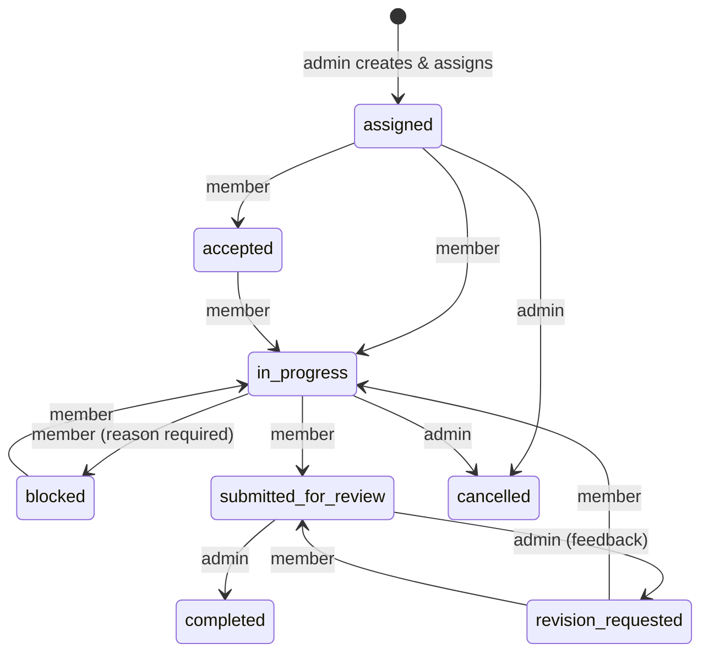
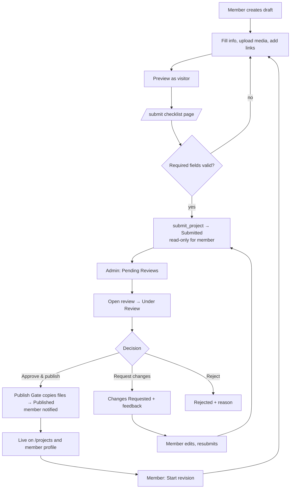

# 03 — App Flow (User, Member & Admin Experience)

**Product:** Inspire Team · **Version:** 1.0 · **Date:** 12 Nov 2026
Related: `01_PRD.md` (IDs) · `02_TRD.md` · `04_UI_UX_Design_Brief.md` · `05_Backend_Schema.md` (names)

---

## 1. Route Map & Guards

**Guards (UX layer; real enforcement is server-side):**
`Public` = anyone · `Auth` = signed-in active user · `Admin` = role admin + AAL2 · `Member` = role member · `PwdOK` = `must_change_password=false`.

### 1.1 Public routes (all indexable unless noted)
| Page | Route | Notes |
|---|---|---|
| Homepage (includes "Meet Our Team" section) | `/` | |
| About the Academy | `/about` | |
| Team Directory | `/team` | |
| Member Profile | `/team/:slug` | 404 if not published |
| All Projects | `/projects` | filters via query: `?q=&category=&tag=&member=&sort=newest|featured&page=` |
| Project Details | `/projects/:slug` | 404 if not visible |
| Project Categories | `/categories` | cards link to `/projects?category=slug` |
| Assignment Showcase | `/showcase`, `/showcase/:slug` | only visible showcases |
| Contact | `/contact` | |
| Search Results | `/search?q=` | projects + members |
| Privacy Policy | `/privacy` | |
| Terms & Conditions | `/terms` | |
| 404 | `*` | `noindex` |

### 1.2 Auth routes (`noindex`)
| Page | Route | Guard |
|---|---|---|
| Admin Login | `/admin/login` | Public |
| Member Login | `/member/login` | Public |
| MFA Setup / Verify (admin) | `/admin/security/mfa` | Auth (admin, aal1 allowed) |
| Forgot / Reset Password | `/forgot-password`, `/reset-password` | Public |
| Change Password (forced/voluntary) | `/change-password` | Auth |

### 1.3 Admin routes (`noindex`, guard `Admin` + `PwdOK`)
| Page | Route |
|---|---|
| Dashboard | `/admin` |
| Team Members | `/admin/members` |
| Add New Member | `/admin/members/new` |
| Member Detail | `/admin/members/:id` |
| Edit Member | `/admin/members/:id/edit` |
| Assignments | `/admin/assignments` |
| Create Assignment | `/admin/assignments/new` |
| Assignment Detail (+edit) | `/admin/assignments/:id` |
| Project Submissions (all) | `/admin/submissions` |
| Pending Reviews | `/admin/reviews` |
| Project Review Detail | `/admin/reviews/:projectId` |
| Published Projects | `/admin/projects/published` |
| Archived Projects | `/admin/projects/archived` |
| File Manager | `/admin/files` |
| Categories | `/admin/categories` |
| Tags | `/admin/tags` |
| Public Content & Showcases | `/admin/content` |
| Profile Change Requests | `/admin/profile-requests` |
| Contact Messages | `/admin/messages` |
| Notifications | `/admin/notifications` |
| Analytics & Reports | `/admin/analytics` |
| Activity Logs | `/admin/activity` |
| Website Settings | `/admin/settings` |
| Security Settings | `/admin/security` |
| Backup & Export | `/admin/backup` |

### 1.4 Member routes (`noindex`, guard `Member` + `PwdOK`)
| Page | Route |
|---|---|
| Dashboard | `/member` |
| My Profile | `/member/profile` |
| My Assignments | `/member/assignments` |
| Assignment Details | `/member/assignments/:id` |
| My Projects | `/member/projects` |
| Create Project | `/member/projects/new` |
| Project Detail / Preview | `/member/projects/:id` |
| Edit Project Draft | `/member/projects/:id/edit` |
| Submit Project (checklist) | `/member/projects/:id/submit` |
| Submission History | `/member/submissions` |
| Revision Requests | `/member/revisions` |
| Uploaded Files | `/member/files` |
| Image-to-PDF Tool | `/member/tools/image-to-pdf` |
| Notifications | `/member/notifications` |
| Account Settings | `/member/settings` |

Role mismatch (e.g., member opens `/admin`) → redirect to own portal home with toast "You don't have access"; unauthenticated → matching login page with `?next=`.

## 2. Global State Patterns (apply to every page)

| State | Behaviour |
|---|---|
| Loading | Skeleton matching the final layout (never a blank page); buttons show spinner and disable |
| Empty | Illustration slot + one-line explanation + primary action (examples in page tables) |
| Success | Toast (auto-dismiss 4 s, `aria-live=polite`) + UI updated |
| Error | Inline error card with "Try again" and short code; form errors beside fields; destructive/forbidden never reveal internals |
| Forbidden | Neutral "Access denied" view |
| Offline/Network | Banner "Connection problem" with retry |
| Confirm | Destructive/irreversible actions (suspend, reject, unpublish, archive, cancel assignment, delete) use `ConfirmDialog` with consequence text |

## 3. Core Flows

### 3.1 Authentication
```mermaid
flowchart TD
  A[/member/login or /admin/login/] --> B{Credentials valid?}
  B -- no --> E[Generic error; rate-limit message if throttled]
  B -- yes --> C{Profile status active?}
  C -- no --> F[Sign out + "Account unavailable, contact admin"]
  C -- yes --> D{Role matches portal?}
  D -- no --> G[Sign out + "Use the correct login page"]
  D -- yes --> H{must_change_password?}
  H -- yes --> I[/change-password/] --> J
  H -- no --> J{Admin?}
  J -- yes --> K{MFA enrolled?}
  K -- no --> L[/admin/security/mfa: enrol TOTP/] --> M
  K -- yes --> N[Enter 6-digit code] --> M[/admin dashboard/]
  J -- no --> O[/member dashboard/]
```
Forgot password: enter email → always show "If the account exists, an email was sent" → `/reset-password` (works only when SMTP configured; otherwise admin resets and shares a new temporary password).

### 3.2 Admin creates a member
1. `/admin/members/new`: full name, email, display name, slug (auto-suggested, editable, uniqueness check), title, optional bio/skills.
2. Submit → `POST /api/admin/members` → success dialog shows **temporary password once** with copy button and warning "It will not be shown again."
3. Member appears in list (status Active, profile unpublished). Audit `member.create`.
4. Admin publishes the public profile when ready (toggle in edit page).

### 3.3 Assignment lifecycle

(States are per member row; assignment-level status is derived — see `05_Backend_Schema.md` §6.)

### 3.4 Project submission & approval

During step O the live page keeps showing the previously approved version.

### 3.5 Image-to-PDF
1. Open tool → empty drop zone ("Drop images here or choose files").
2. Add images → validation (type, ≤ 10 MB each, magic bytes) → thumbnails (rejected files listed with reasons).
3. Arrange: drag or ▲▼ buttons, rotate ⟲⟳, remove ✕.
4. Settings: page size (A4/Letter/Auto Fit), orientation, margin, fit mode, quality preset + slider, filename.
5. **Generate PDF** → progress bar (`n of N`), Cancel available.
6. Result card: size, pages, preview, **Download**, **Attach to project** (choose draft/changes-requested project) with optional checkbox "Also save original images to the gallery" (off by default).
7. If size > limit: warning + "Use Small preset" button; attach disabled until under limit.
8. After attaching: success toast and link to the project; memory released.

### 3.6 Publishing flow (admin screen detail)
`/admin/reviews/:projectId` layout: header (title, member, status badge, version no.) → tabs **Content** · **Media** · **Versions** · **Feedback & Notes**. Right-side action panel: Start review, **Approve & Publish**, Request Changes, Reject, Add internal note, Preview as visitor, Feature toggle, Change category, Edit public content. Approve → modal: confirm slug, featured toggle, summary of files to be published → progress ("Verifying files 2/5") → success or specific failure (file name + reason).

### 3.7 Contact
Visitor fills name, email, subject, message (+ hidden honeypot) → `POST /api/contact` → success message; admin sees `contact_message` notification and the item in `/admin/messages`. WhatsApp button opens `https://wa.me/<number>` in a new tab (hidden if no number configured).

### 3.8 Language & theme
Header toggle on every layout: EN/اردو and Light/Dark/System. Switching updates `<html lang dir>` instantly without reload; choice saved locally and (if signed in) to `profiles`.

## 4. Public Page Specifications

| Page | Purpose & content | Key actions | Empty state |
|---|---|---|---|
| Homepage | Hero (academy name, tagline, CTAs), stats (members, projects), featured projects (≤ 6), categories, **Meet Our Team** (≤ 8 members), showcase teaser, contact CTA — blocks configurable via `public_content.home` | Browse projects, view team, contact | "Projects will appear here soon" |
| About | Academy story/mission from `public_content.about`, values, contact CTA | — | Placeholder text |
| Team Directory | Grid of published members (avatar, name, title, top skills), search by name/skill | Open profile | "No team members published yet" |
| Member Profile | Avatar, name, title, bio, skills, specializations, experience, social links, contact button (if enabled), stats (project count, categories), featured projects, all approved projects grid, showcases they took part in | Filter by category, open project, contact | "No published projects yet" |
| All Projects | Search box, filters (category, technology tag, member), sort, cards (cover, title, category, member, tags), pagination 12/page | Filter/search, open project | "No projects match your filters" + Clear filters |
| Categories | Category cards with counts | Open filtered list | "No categories" |
| Project Details | Cover/gallery (lightbox, keyboard accessible), title, short + full description, category, tags, member card + collaborators, completion date, role, link buttons (Website, Live Preview, GitHub, Android, Play Store, Download — only those present), PDF viewer/download, related projects (same category) | Open links (new tab, `noopener`), download PDF, share | 404 view |
| Assignment Showcase | Cards of admin-authored showcases; detail shows title, summary, cover, optional date, shown members, link to project | Open detail | "No showcases yet" |
| Contact | Intro text, form, WhatsApp button, email/phone/address/social from settings, validation messages, success state "Message sent" | Send message | — |
| Search Results | Tabs Projects / Members; counts; same cards | Open result | "No results for “q”" with suggestions |
| Privacy / Terms | Markdown from `public_content` | — | Placeholder |
| 404 | Friendly message, search box, links home/projects | — | — |

## 5. Admin Page Specifications

Common table behaviour: server-side pagination (20), sortable columns, search, filters, empty state, bulk actions only where stated, CSV export where stated.

| Page | Purpose & key content | Actions | Empty state |
|---|---|---|---|
| Admin Login | Email, password, error area, link "Forgot password" | Sign in | — |
| MFA Setup | QR + secret, 6-digit verify; recovery guidance text | Enrol/verify | — |
| Dashboard | KPI cards (members total/active/suspended; assignments pending/in-progress/completed/overdue; projects submitted/awaiting review/published/rejected/changes requested; files & storage vs quota), charts (submissions per week, projects by category, assignments by status), lists (pending approvals, recent submissions, upcoming deadlines, recent member activity, recent admin actions); filters (date range, member, category); export | Click-through to lists | Zero-state tiles with hints |
| Team Members | Table: avatar, name, email, status, published?, projects count, last login; filter by status; search | Add, edit, suspend/activate, reset password, open detail | "No members yet — add your first member" |
| Add / Edit Member | Account (name, email — email read-only after create, role fixed `member`), public profile (slug, display name, title EN/UR, bio EN/UR, skills, specializations, experience, social links, avatar upload, contact toggle + public email, SEO fields, published toggle, sort order) | Save, upload avatar, publish toggle | — |
| Member Detail | Summary, status, assigned work, projects by status, files usage, activity timeline (from `audit_logs`) | Suspend/activate/deactivate, reset password (temp password dialog), edit | — |
| Assignments | Table with filters (status, priority, member, overdue, date) and search | Create, open | "No assignments yet" |
| Create / Edit Assignment | Fields per PRD ASSIGN-001, member multi-select, attachments (private upload), reference links, admin-only notes | Save/assign, cancel | — |
| Assignment Detail | Overview, per-member progress/status table with feedback box, comment thread (shared/admin-only toggle), attachments, linked projects, showcase section (create/edit/toggle visibility) | Request revision, complete, cancel (reason), reassign, comment | — |
| Project Submissions | All projects with status chips, filters (status, member, category, date), search | Open review | "No submissions yet" |
| Pending Reviews | Queue sorted oldest first (submitted + under review), SLA age badge | Open review | "Nothing waiting — all caught up" |
| Project Review Detail | See §3.6 | all review actions | — |
| Published Projects | Table of live rows (visible/hidden), featured toggle + order drag, quick edit, hide/unpublish, republish | Feature, edit, unpublish | "No published projects" |
| Archived Projects | Archived list | Restore | "Archive is empty" |
| File Manager | Table of `files` (name, owner, kind, size, status, bucket, linked entity), filters, usage summary by member/kind, signed preview, orphan candidates tab | Preview, download, soft delete, run orphan cleanup | "No files" |
| Categories | Sortable list, create/edit (EN/UR names, icon, project_type, active) | Add/edit/reorder/deactivate | Default categories seeded |
| Tags | List with kind, approval state, usage count; merge/rename | Approve, edit, delete unused | "No tags" |
| Public Content & Showcases | Tabs: Home blocks, About, Privacy, Terms, Contact intro (EN/UR markdown editors with preview), Showcases list | Save, publish toggle | Placeholder content |
| Profile Change Requests | Pending/decided list with diff (current vs requested) | Approve/reject with response | "No requests" |
| Contact Messages | Inbox with status chips | Mark read/replied/spam/archive, add note, copy email | "No messages yet" |
| Notifications | Full history, filters, mark all read | Open linked item | "No notifications" |
| Analytics & Reports | Date range + member/category filters; charts (submissions trend, approval rate, avg review time, per-member output, category distribution, storage by member); tables; **Export CSV/JSON** | Export | "No data for this period" |
| Activity Logs | Table (time, actor, action, entity, outcome) with filters and CSV export; read-only | Filter/export | "No activity" |
| Website Settings | Tabs: Branding (name, logo, colours), Localization (default language), SEO defaults, Contact (WhatsApp, email, phone, address), Social links, Files & limits, PDF tool limits, Features | Save (audited) | — |
| Security Settings | MFA status, change password, sign out of all devices, idle timeout values (read), checklist of Supabase auth settings to verify | Actions | — |
| Backup & Export | Export JSON/CSV per table or all; last export time; storage report; orphan cleanup; written manual backup instructions (DB + Storage) | Export, cleanup | — |

## 6. Member Page Specifications

| Page | Purpose & content | Actions | Empty state |
|---|---|---|---|
| Member Login | Email/password, forgot link, language/theme toggles | Sign in | — |
| Change Password | New password with strength hints (≥ 10 chars, letter + number), confirm | Save → `must_change_password=false` | — |
| Dashboard | Greeting, cards: active assignments, due soon, projects by status, changes requested (highlight), unread notifications; quick actions (New project, Open PDF tool) | Navigate | "No assignments yet — enjoy the calm" |
| My Profile | Read-only view of public profile + status (published or not); **Request change** form (whitelisted fields) with pending-request indicator | Submit request | — |
| My Assignments | List/cards with priority, due date, my status/progress; filters | Open | "No assignments" |
| Assignment Details | Description, instructions, reference links, private attachments (signed download), my status control (Accept / Start / Blocked + reason / Submit for review), progress slider (0–100), submission note, link/create project, comment thread (shared) | Update status, comment | — |
| My Projects | Cards/table with status badge, "Published · revision in progress" badge, filters | New, open, edit | "Create your first project" |
| Create / Edit Project | Sections: Basics (title, category, short/full description EN + optional UR), Media (cover, gallery with reorder + alt text, PDF), Links, Tags (pick or suggest), Collaborators (credits), Details (completion date, role), Assignment link, SEO suggestions; autosave draft every 30 s and on blur; inline validation | Save, preview, go to submit | — |
| Project Detail / Preview | Visitor-style preview + status panel + admin feedback timeline | Edit (if editable), start revision (if published), withdraw (if submitted) | — |
| Submit Project | Checklist with ✓/✗ per requirement, summary, confirm | Submit | — |
| Submission History | Versions with dates, decisions, feedback | Open | "Nothing submitted yet" |
| Revision Requests | Projects in `changes_requested` + assignment revisions with admin feedback | Open to edit | "No pending revisions" |
| Uploaded Files | Own files by kind/status, quota meter, duplicates flag | Preview (signed URL), soft delete (if unreferenced) | "No files yet" |
| Image-to-PDF Tool | See §3.5 | Generate, download, attach | — |
| Notifications | History, mark read/all | Open linked item | "You're all caught up" |
| Account Settings | Language, theme, notification toggles, change password, sign out of all devices | Save | — |

## 7. Permission Summary per Role

| Capability | Visitor | Member | Admin |
|---|---|---|---|
| View published content | ✅ | ✅ | ✅ |
| Own drafts/assignments/files | — | ✅ own only | ✅ all |
| Submit project | — | ✅ | ✅ (on behalf not in MVP) |
| Approve / publish / unpublish / archive / feature | — | ❌ | ✅ |
| Create/edit assignments | — | ❌ (update own progress only) | ✅ |
| Create/suspend members | — | ❌ | ✅ |
| Edit public profile/content/settings | — | ❌ (request only) | ✅ |
| View audit log, analytics, backups | — | ❌ | ✅ |

## 8. Edge Cases

| Case | Behaviour |
|---|---|
| Member opens a project URL they don't own | Not found view (no existence leak) |
| Slug collision on create/edit | Field error + suggestion with suffix |
| Upload fails mid-way | Retry ×3, then error with "Try again"; pending row cleaned |
| Two admins/tabs publish same project | Second attempt gets `ERR_INVALID_STATE` → "Already published" |
| Member suspended while logged in | Next request returns empty/denied → app signs out with message |
| Publish Gate rejects a file | Nothing published, copied files removed, message names the file and reason |
| Admin unpublishes project with pending revision | Live hidden; revision continues; later publish re-creates visibility |
| Image set too large for memory | Stop, free memory, advise fewer images or Small preset |
| No WhatsApp number configured | Button hidden |
| Language has no translated content | Falls back to English text |
