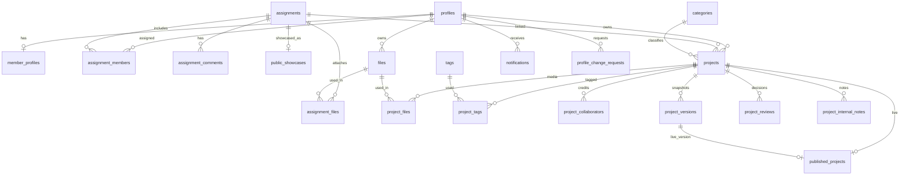

# 05 — Backend Schema (Supabase / PostgreSQL)

**Product:** Inspire Team · **Version:** 1.0 · **Date:** 12 Nov 2026
**This is a planning document.** It does not create a database. ChatGPT (with Supabase + GitHub plugins) creates the real project from this file and the final code. AI Studio must use these **exact** table, column, enum, RPC and bucket names in its service layer.
Related: `01_PRD.md` · `02_TRD.md` · `03_App_Flow.md` · `06_Implementation_Plan.md`

Section map (referenced by other documents): §1 Conventions & Enums · §2 Tables & ER · §3 Helper functions & guard triggers · §4 RLS policies · §5 Indexes · §6 Derived logic · §7 RPC catalog · §8 Storage · §9 Jobs/Realtime/Seed · §10 Snapshot JSON · §11 Audit catalog.

---

## 1. Conventions & Enums

- Schema `public`. Primary keys `uuid default gen_random_uuid()` unless stated. Timestamps `timestamptz default now()`. Every mutable table has `created_at`, `updated_at` (trigger `set_updated_at`).
- Names: `snake_case`, plural tables. Enum values are lowercase snake_case.
- **RLS enabled on every table.** `anon` and `authenticated` get privileges only through policies below; revoke default broad grants.
- All `SECURITY DEFINER` functions: `set search_path = public`, owned by a non-login role, `revoke all … from public`, `grant execute` only to intended roles.
- URL columns: `CHECK (col is null or col ~* '^https?://[^\s]+$')` and `length ≤ 500`.
- Soft delete via `deleted_at` where listed. Hard delete only by admin cleanup.

```sql
create type user_role            as enum ('admin','member');
create type account_status       as enum ('active','suspended','deactivated');
create type project_status       as enum ('draft','submitted','under_review','changes_requested','published','rejected','archived');
create type assignment_status    as enum ('assigned','accepted','in_progress','blocked','submitted_for_review','revision_requested','completed','cancelled');
create type assignment_priority  as enum ('low','medium','high','urgent');
create type review_decision      as enum ('approved_published','rejected','changes_requested','unpublished','republished','archived','restored','featured','unfeatured');
create type file_kind            as enum ('project_cover','project_gallery','project_pdf','assignment_attachment','avatar','site_asset','showcase_cover','profile_request_attachment');
create type file_status          as enum ('pending','active','replaced','deleted');
create type file_visibility      as enum ('private','public');
create type contact_status       as enum ('new','read','replied','spam','archived');
create type change_request_status as enum ('pending','approved','rejected');
create type tag_kind             as enum ('technology','topic');
create type comment_visibility   as enum ('shared','admin_only');
```

## 2. Tables

### 2.1 Identity & profiles
```text
profiles                       -- 1:1 with auth.users; PRIVATE
  id uuid PK → auth.users(id) ON DELETE CASCADE
  email text NOT NULL UNIQUE
  full_name text NOT NULL (2–120)
  role user_role NOT NULL DEFAULT 'member'
  status account_status NOT NULL DEFAULT 'active'
  must_change_password boolean NOT NULL DEFAULT true
  phone text NULL
  preferred_language text NOT NULL DEFAULT 'en' CHECK in ('en','ur')
  preferred_theme text NOT NULL DEFAULT 'system' CHECK in ('light','dark','system')
  notification_prefs jsonb NOT NULL DEFAULT '{}'   -- {"deadline_approaching":true,...}
  last_login_at timestamptz NULL
  created_by uuid NULL → profiles(id)
  deactivated_at timestamptz NULL
  created_at, updated_at

member_profiles                -- PUBLIC when is_published; admin-controlled content
  id uuid PK
  profile_id uuid NOT NULL UNIQUE → profiles(id) ON DELETE CASCADE
  slug text NOT NULL UNIQUE CHECK (slug ~ '^[a-z0-9]+(-[a-z0-9]+)*$' AND length 3–60)
  display_name text NOT NULL
  title text NULL, title_ur text NULL
  bio text NULL (≤ 2000), bio_ur text NULL
  skills text[] NOT NULL DEFAULT '{}'
  specializations text[] NOT NULL DEFAULT '{}'
  experience_text text NULL
  avatar_file_id uuid NULL → files(id)
  avatar_public_path text NULL        -- path in public-media
  github_url, linkedin_url, website_url text NULL (URL check)
  other_links jsonb NOT NULL DEFAULT '[]'   -- [{label,url}]
  public_contact_email text NULL      -- public by design; admin sets only if intended
  contact_enabled boolean NOT NULL DEFAULT false
  is_published boolean NOT NULL DEFAULT false
  sort_order int NOT NULL DEFAULT 0
  seo_title text NULL, seo_description text NULL
  created_at, updated_at

profile_change_requests
  id uuid PK
  member_id uuid NOT NULL → profiles(id)
  requested_changes jsonb NOT NULL     -- whitelisted keys of member_profiles
  note text NULL
  status change_request_status NOT NULL DEFAULT 'pending'
  admin_response text NULL
  reviewed_by uuid NULL → profiles(id), reviewed_at timestamptz NULL
  created_at, updated_at
```

### 2.2 Taxonomy
```text
categories
  id uuid PK, slug text UNIQUE NOT NULL, name_en text NOT NULL, name_ur text NULL
  description_en text NULL, description_ur text NULL
  icon text NULL                       -- lucide icon name
  project_type text NOT NULL DEFAULT 'general' CHECK in ('web','android','design','general')  -- drives conditional validation
  sort_order int DEFAULT 0, is_active boolean DEFAULT true, created_at, updated_at

tags
  id uuid PK, slug text UNIQUE NOT NULL, name_en text NOT NULL, name_ur text NULL
  kind tag_kind NOT NULL DEFAULT 'technology'
  is_approved boolean NOT NULL DEFAULT false   -- member-created tags start unapproved
  created_by uuid NULL → profiles(id), created_at
```

### 2.3 Files
```text
files                          -- metadata only; binaries live in Storage
  id uuid PK
  owner_id uuid NOT NULL → profiles(id)
  bucket text NOT NULL CHECK in ('private-files','public-media')
  storage_path text NOT NULL         -- members/{owner_id}/{id}.{ext} | assignments/{assignment_id}/{id}.{ext} | public paths
  original_name text NOT NULL (sanitised, ≤ 200)
  mime_type text NOT NULL CHECK in ('image/jpeg','image/png','image/webp','application/pdf')
  size_bytes bigint NOT NULL CHECK (size_bytes > 0 AND size_bytes <= 10485760)
  sha256 text NULL
  kind file_kind NOT NULL
  status file_status NOT NULL DEFAULT 'pending'
  visibility file_visibility NOT NULL DEFAULT 'private'
  public_path text NULL              -- set by Publish Gate when copied to public-media
  replaces_file_id uuid NULL → files(id)
  version_no int NOT NULL DEFAULT 1
  width int NULL, height int NULL, page_count int NULL
  alt_text text NULL
  activated_at timestamptz NULL, deleted_at timestamptz NULL
  created_at, updated_at
  UNIQUE (bucket, storage_path)
```

### 2.4 Assignments
```text
assignments                    -- PRIVATE (never public)
  id uuid PK
  title text NOT NULL (3–150)
  description text NULL, instructions text NULL
  priority assignment_priority NOT NULL DEFAULT 'medium'
  start_date date NULL, due_date date NULL CHECK (due_date >= start_date)
  estimated_hours numeric(6,1) NULL
  reference_links jsonb NOT NULL DEFAULT '[]'    -- [{label,url}]
  status assignment_status NOT NULL DEFAULT 'assigned'   -- DERIVED (§6), do not write from client
  progress int NOT NULL DEFAULT 0 CHECK 0–100            -- DERIVED
  created_by uuid NOT NULL → profiles(id)
  completed_at timestamptz NULL, completed_by uuid NULL → profiles(id)
  cancelled_at timestamptz NULL, cancelled_by uuid NULL → profiles(id), cancel_reason text NULL
  deleted_at timestamptz NULL
  created_at, updated_at

assignment_admin_notes         -- ADMIN ONLY (private notes live here, not on assignments)
  assignment_id uuid PK → assignments(id) ON DELETE CASCADE
  notes text NOT NULL DEFAULT ''
  updated_by uuid NULL → profiles(id), updated_at

assignment_members
  id uuid PK
  assignment_id uuid NOT NULL → assignments(id) ON DELETE CASCADE
  member_id uuid NOT NULL → profiles(id)
  status assignment_status NOT NULL DEFAULT 'assigned'
  progress int NOT NULL DEFAULT 0 CHECK 0–100
  blocked_reason text NULL
  submission_note text NULL
  admin_feedback text NULL           -- visible to this member
  accepted_at, started_at, submitted_at, completed_at timestamptz NULL
  created_at, updated_at
  UNIQUE (assignment_id, member_id)

assignment_files
  assignment_id → assignments(id) ON DELETE CASCADE, file_id → files(id), PRIMARY KEY (assignment_id, file_id)

assignment_comments
  id uuid PK, assignment_id → assignments(id) ON DELETE CASCADE
  author_id → profiles(id), visibility comment_visibility NOT NULL DEFAULT 'shared'
  body text NOT NULL (1–2000), edited_at NULL, deleted_at NULL, created_at

public_showcases               -- ONLY admin-authored public fields
  id uuid PK
  assignment_id uuid NOT NULL UNIQUE → assignments(id)
  slug text UNIQUE NOT NULL
  title text NOT NULL, title_ur text NULL
  summary text NOT NULL (≤ 1000), summary_ur text NULL
  category_id uuid NULL → categories(id)
  cover_file_id uuid NULL → files(id), cover_public_path text NULL
  show_completed_date boolean NOT NULL DEFAULT false, completed_on date NULL
  shown_members jsonb NOT NULL DEFAULT '[]'      -- [{display_name,slug}] chosen by admin
  linked_project_slug text NULL                  -- optional link to a published project
  is_visible boolean NOT NULL DEFAULT false
  published_at timestamptz NULL
  created_by → profiles(id), created_at, updated_at
```

### 2.5 Projects
```text
projects                       -- WORKING COPY; PRIVATE (owner + admin)
  id uuid PK
  owner_id uuid NOT NULL → profiles(id)
  assignment_id uuid NULL → assignments(id)
  status project_status NOT NULL DEFAULT 'draft'
  title text NOT NULL (3–120), title_ur text NULL
  slug text NOT NULL UNIQUE            -- auto from title + 4-char suffix; fixed at first publish
  short_description text NULL (≤ 200), short_description_ur text NULL
  full_description text NULL (≤ 5000), full_description_ur text NULL
  category_id uuid NULL → categories(id)
  website_url, live_preview_url, github_url, android_app_url, play_store_url, app_download_url text NULL (URL checks)
  completion_date date NULL CHECK (completion_date <= current_date)
  role_contribution text NULL (≤ 500)
  seo_title text NULL (≤ 70), seo_description text NULL (≤ 160)
  version_count int NOT NULL DEFAULT 0
  live_version_id uuid NULL → project_versions(id)
  submitted_at timestamptz NULL, last_decision_at timestamptz NULL
  status_before_archive project_status NULL, archived_at timestamptz NULL
  deleted_at timestamptz NULL           -- drafts only, by owner
  created_at, updated_at

project_files                  -- working-copy media
  id uuid PK, project_id → projects(id) ON DELETE CASCADE, file_id → files(id)
  role text NOT NULL CHECK in ('cover','gallery','pdf'), sort_order int DEFAULT 0, alt_text text NULL
  UNIQUE (project_id, file_id)
  -- constraints: max 1 cover, max 1 pdf, max 12 gallery per project (trigger)

project_tags     project_id → projects(id) ON DELETE CASCADE, tag_id → tags(id), PRIMARY KEY (project_id, tag_id)  -- max 10 (trigger)

project_collaborators
  id uuid PK, project_id → projects(id) ON DELETE CASCADE, member_id → profiles(id), role_label text NULL
  UNIQUE (project_id, member_id)            -- display credit only, no private access

project_versions               -- IMMUTABLE snapshots (only status/decided_at may change)
  id uuid PK, project_id → projects(id) ON DELETE CASCADE
  version_no int NOT NULL, snapshot jsonb NOT NULL (§10)
  status text NOT NULL DEFAULT 'pending_review' CHECK in ('pending_review','approved','rejected','changes_requested','superseded','withdrawn')
  submitted_by → profiles(id), submitted_at timestamptz DEFAULT now(), decided_at timestamptz NULL
  UNIQUE (project_id, version_no)

project_reviews                -- member-visible decisions
  id uuid PK, project_id → projects(id) ON DELETE CASCADE, version_id → project_versions(id) NULL
  reviewer_id → profiles(id), decision review_decision NOT NULL
  feedback text NULL     -- required for rejected / changes_requested
  created_at

project_internal_notes         -- ADMIN ONLY
  id uuid PK, project_id → projects(id) ON DELETE CASCADE, version_id NULL, author_id → profiles(id), note text NOT NULL, created_at

published_projects             -- PUBLIC LIVE SNAPSHOT (only written by admin_publish_project / admin edit)
  id uuid PK
  project_id uuid NOT NULL UNIQUE → projects(id)
  version_id uuid NOT NULL → project_versions(id)
  owner_id uuid NOT NULL → profiles(id)
  owner_display_name text NOT NULL
  slug text NOT NULL UNIQUE
  title text NOT NULL, title_ur text NULL
  short_description text NOT NULL, short_description_ur text NULL
  full_description text NULL, full_description_ur text NULL
  category_id uuid NOT NULL → categories(id)
  tags jsonb NOT NULL DEFAULT '[]'              -- [{slug,name_en,name_ur,kind}]
  tag_slugs text[] NOT NULL DEFAULT '{}'
  cover_public_path text NOT NULL
  gallery jsonb NOT NULL DEFAULT '[]'           -- [{path,alt,sort_order}]
  pdf_public_path text NULL
  website_url, live_preview_url, github_url, android_app_url, play_store_url, app_download_url text NULL
  completion_date date NULL
  role_contribution text NULL
  collaborators jsonb NOT NULL DEFAULT '[]'     -- [{display_name,slug,role_label}]
  seo_title text NULL, seo_description text NULL
  is_visible boolean NOT NULL DEFAULT true
  is_featured boolean NOT NULL DEFAULT false, featured_order int NULL
  member_sort_order int NOT NULL DEFAULT 0
  published_at timestamptz NOT NULL DEFAULT now()
  unpublished_at timestamptz NULL
  search_vector tsvector (maintained by trigger from title, short_description, tag names, owner_display_name; config 'simple')
  updated_at
```

### 2.6 Operations & content
```text
notifications
  id uuid PK, recipient_id → profiles(id) ON DELETE CASCADE
  type text NOT NULL (see PRD NOTIF-002/003), title text NOT NULL, body text NULL
  link_path text NULL, entity_type text NULL, entity_id uuid NULL
  is_read boolean DEFAULT false, read_at timestamptz NULL
  email_status text NOT NULL DEFAULT 'not_applicable'   -- reserved for Phase 2
  created_at

audit_logs                     -- APPEND-ONLY
  id bigint GENERATED ALWAYS AS IDENTITY PK
  actor_id uuid NULL, actor_role text NULL
  action text NOT NULL (§11), entity_type text NOT NULL, entity_id text NULL
  outcome text NOT NULL DEFAULT 'success' CHECK in ('success','failure','denied')
  metadata jsonb NOT NULL DEFAULT '{}'      -- never passwords/tokens
  request_id text NULL, ip_hash text NULL
  created_at

site_settings
  key text PK, value jsonb NOT NULL, is_public boolean NOT NULL DEFAULT false
  updated_by uuid NULL → profiles(id), updated_at

public_content
  id uuid PK, page_key text UNIQUE NOT NULL CHECK in ('home','about','privacy','terms','contact_intro')
  title_en text, title_ur text, body_en text, body_ur text    -- markdown, no raw HTML
  sections jsonb NOT NULL DEFAULT '[]'                        -- home blocks [{type,title_en,title_ur,body_en,body_ur,image_path}]
  is_published boolean DEFAULT true, updated_by NULL, updated_at

contact_submissions            -- ADMIN ONLY (inserted by Function with service role)
  id uuid PK, name text, email text, phone text NULL, subject text, message text (≤ 3000)
  status contact_status DEFAULT 'new', admin_notes text NULL
  ip_hash text, user_agent text NULL, handled_by NULL, handled_at NULL, created_at
```

### 2.7 ER overview


## 3. Helper Functions & Guard Triggers

```sql
-- Active admin AND MFA-verified session (aal2)
create function public.is_admin() returns boolean language sql stable security definer set search_path=public as $$
  select exists (select 1 from profiles p where p.id = auth.uid() and p.role='admin' and p.status='active')
     and coalesce(auth.jwt()->>'aal','aal1') = 'aal2'
$$;
-- Any active user (admin or member)
create function public.is_active_user() returns boolean language sql stable security definer set search_path=public as $$
  select exists (select 1 from profiles p where p.id = auth.uid() and p.status='active')
$$;
create function public.is_assigned_member(p_assignment uuid) returns boolean language sql stable security definer set search_path=public as $$
  select is_active_user() and exists (select 1 from assignment_members am where am.assignment_id=p_assignment and am.member_id=auth.uid() and am.status <> 'cancelled')
$$;
create function public.owns_project(p_project uuid) returns boolean language sql stable security definer set search_path=public as $$
  select is_active_user() and exists (select 1 from projects p where p.id=p_project and p.owner_id=auth.uid() and p.deleted_at is null)
$$;
create function public.member_storage_used(p_member uuid) returns bigint ... -- sum(size_bytes) of files status in ('pending','active') for owner
```
Other internal functions: `set_updated_at()`, `notify(recipient uuid, type text, title text, body text, link text, entity_type text, entity_id uuid)` (respects `notification_prefs`; **not** granted to clients), `write_audit(action, entity_type, entity_id, outcome, metadata)` (not granted to clients), `notify_admins(...)`, `recalc_assignment_status(p_assignment uuid)`, `slugify(text)`.

**Guard triggers** (BEFORE UPDATE/INSERT). Rule: when `current_user in ('authenticated','anon')` and not `is_admin()`, enforce — inside `SECURITY DEFINER` RPCs `current_user` is the function owner so transitions are allowed.
| Trigger | Blocks for non-admin clients |
|---|---|
| `guard_profile_update` | Any change to `email, full_name, role, status, created_by, deactivated_at`; `must_change_password` may only go `true → false` on own row |
| `guard_project_update` | Changes to `owner_id, status, slug, version_count, live_version_id, submitted_at, last_decision_at, status_before_archive, archived_at`; any edit unless `status in ('draft','changes_requested')` |
| `guard_project_children` | Insert/update/delete on `project_files/project_tags/project_collaborators` unless parent is owned and editable (`draft`/`changes_requested`); enforces max counts |
| `guard_assignment_member_update` | Members may change only `status` (to accepted/in_progress/blocked/submitted_for_review per allowed transitions), `progress`, `blocked_reason`, `submission_note` — and only via `update_my_assignment` |
| `guard_files_update` | Members cannot change `owner_id, bucket, storage_path, kind, visibility, public_path, mime_type, size_bytes`; may set `pending→active` once |
| `guard_published_projects` | Non-admin writes impossible (also no policy) |
| `sync_member_visibility` | On `profiles.status` → suspended/deactivated: set `member_profiles.is_published=false` |
| `protect_versions` | `project_versions.snapshot`, `version_no`, `project_id` immutable |
| `audit_*` triggers | Row-change auditing for admin edits on `published_projects`, `site_settings`, `categories`, `member_profiles` |

## 4. RLS Policies

Legend: ✅ allowed · own = `owner_id/member_id/recipient_id = auth.uid()` and `is_active_user()` · A = `is_admin()` · — = no policy (denied).

| Table | anon | member (active) | admin |
|---|---|---|---|
| `profiles` | — | SELECT own row *(works at aal1 so login can load it)*; UPDATE own (guarded) | A: SELECT all, UPDATE all; INSERT/DELETE only via Function (service role) |
| `member_profiles` | SELECT where `is_published` | SELECT own (even unpublished); no write | A: ALL |
| `profile_change_requests` | — | INSERT own (via RPC), SELECT own | A: SELECT/UPDATE (via RPC) |
| `categories` | SELECT where `is_active` | SELECT where `is_active` | A: ALL |
| `tags` | SELECT where `is_approved` | SELECT approved + own unapproved; INSERT (forced `is_approved=false`, `created_by=uid`) | A: ALL |
| `files` | — | SELECT own (not deleted); INSERT own with checks (`owner_id=uid`, bucket `private-files`, `status='pending'`, `size ≤ limit`, quota not exceeded, kind in member kinds); UPDATE own guarded | A: ALL |
| `assignments` | — | SELECT where `is_assigned_member(id)` and `deleted_at is null` | A: ALL |
| `assignment_members` | — | SELECT own row; UPDATE own via RPC only | A: ALL |
| `assignment_admin_notes` | — | — | A: ALL |
| `assignment_files` | — | SELECT where `is_assigned_member(assignment_id)` | A: ALL |
| `assignment_comments` | — | SELECT where `is_assigned_member` and (`visibility='shared'`); INSERT own `shared` only | A: ALL |
| `public_showcases` | SELECT where `is_visible` | same as anon | A: ALL |
| `projects` | — | SELECT own (`deleted_at is null`); INSERT own (`status='draft'`); UPDATE own while editable (guarded); DELETE — (soft delete via `UPDATE deleted_at` only while draft) | A: ALL |
| `project_files`, `project_tags`, `project_collaborators` | — | SELECT/INSERT/UPDATE/DELETE where `owns_project(project_id)` (guarded: only editable states) | A: ALL |
| `project_versions` | — | SELECT where `owns_project(project_id)` | A: SELECT |
| `project_reviews` | — | SELECT where `owns_project(project_id)` | A: SELECT (writes via RPC) |
| `project_internal_notes` | — | — | A: ALL |
| `published_projects` | SELECT where `is_visible` | same as anon | A: ALL (edits audited) |
| `notifications` | — | SELECT own; UPDATE via `mark_notifications_read` RPC only | SELECT own |
| `audit_logs` | — | — | A: SELECT only (no INSERT/UPDATE/DELETE policy for anyone; written by definer functions) |
| `site_settings` | SELECT where `is_public` | SELECT where `is_public` or `key in ('file_limits','pdf_tool','security')` | A: ALL |
| `public_content` | SELECT where `is_published` | same | A: ALL |
| `contact_submissions` | — | — | A: SELECT/UPDATE/DELETE (insert by Function service role) |

**Assignment private notes:** stored in `assignment_admin_notes` (admin-only RLS, no member policy) so `assignments` can be safely readable by assigned members. The `assignments` table has **no** `private_admin_notes` column.

**Never** allow `anon` SELECT on: `profiles, files, assignments, assignment_*, projects, project_versions, project_reviews, project_internal_notes, notifications, audit_logs, contact_submissions, profile_change_requests`.

## 5. Indexes

| Index | Purpose |
|---|---|
| `published_projects (is_visible, is_featured desc, featured_order, published_at desc)` | listings |
| `published_projects (category_id) WHERE is_visible` | filter |
| `published_projects (owner_id) WHERE is_visible` | member page |
| `published_projects USING gin (tag_slugs)` | tag filter |
| `published_projects USING gin (search_vector)` | full-text search |
| `published_projects USING gin (title gin_trgm_ops)` | partial match (extension `pg_trgm`) |
| `member_profiles (is_published, sort_order)`; unique `slug`; `gin (skills)`; `gin (display_name gin_trgm_ops)` | directory/search |
| `projects (owner_id, status) WHERE deleted_at is null` | member lists |
| `projects (status, submitted_at) WHERE status in ('submitted','under_review')` | review queue |
| `projects (assignment_id)` | linkage |
| `project_versions (project_id, version_no desc)` | history |
| `assignment_members (member_id, status)`; `(assignment_id)` | dashboards |
| `assignments (status, due_date) WHERE deleted_at is null` | deadlines |
| `files (owner_id, status)`; `(owner_id, sha256)`; `(status, created_at)` | quota, duplicates, cleanup |
| `notifications (recipient_id, is_read, created_at desc)` | bell |
| `audit_logs (created_at desc)`; `(actor_id, created_at desc)`; `(entity_type, entity_id)` | activity log |
| `contact_submissions (status, created_at desc)`; `(ip_hash, created_at)` | inbox, rate limit |
| `profile_change_requests (status, created_at)` | inbox |

## 6. Derived Logic

**Assignment status (trigger `recalc_assignment_status` after any `assignment_members` change):**
1. `cancelled_at is not null` → `cancelled`
2. else `completed_at is not null` → `completed`
3. else, over **non-cancelled** member rows, take the first that exists in this order: `blocked` → `submitted_for_review` → `revision_requested` → `in_progress` → `accepted` → `assigned`.
`progress` = rounded average of non-cancelled member rows (0 if none).

**Member-allowed transitions (`update_my_assignment`):**
`assigned→accepted`, `accepted→in_progress`, `assigned→in_progress`, `in_progress→blocked`, `blocked→in_progress`, `in_progress→submitted_for_review`, `revision_requested→in_progress`, `revision_requested→submitted_for_review`. `blocked` requires `blocked_reason`. All others → `ERR_INVALID_STATE`.

**Admin actions:** `admin_request_assignment_revision(member_row, feedback)` → `revision_requested`; `admin_complete_assignment(assignment)` → all non-cancelled rows `completed`, assignment `completed_at`; `admin_cancel_assignment(assignment, reason)`; reassign = admin sets a member row `cancelled` and inserts a new row (audited).

**Overdue:** `due_date < current_date` and status not in (`completed`,`cancelled`) — computed in queries/stats, no stored flag.

**Project visibility:** public reads only `published_projects.is_visible`. **Slug:** `slugify(title) || '-' || 4 random chars` at creation; admin may edit after first publish; `published_projects.slug` is the public URL.

**Search:** `search_vector = setweight(to_tsvector('simple', title),'A') || setweight(to_tsvector('simple', coalesce(short_description,'')),'B') || setweight(to_tsvector('simple', owner_display_name || ' ' || array_to_string(tag_slugs,' ')),'C')`.

**Storage quota:** `member_storage_used(uid) + new.size_bytes <= file_limits.per_member_quota_mb * 1048576` checked in `files` INSERT policy; error `ERR_QUOTA`.

## 7. RPC Catalog

All RPCs: `SECURITY DEFINER`, verify caller inside, write audit, raise `ERR_*` exceptions (`ERR_FORBIDDEN, ERR_NOT_FOUND, ERR_INVALID_STATE, ERR_VALIDATION, ERR_CONFLICT, ERR_QUOTA`).

### Member RPCs (caller must be active member who owns the record)
| RPC | Effect |
|---|---|
| `submit_project(p_project_id uuid)` | Requires status `draft`/`changes_requested`; validates PRD §10.1 and that all `project_files` are `active` and owned; `version_count+1`; insert `project_versions` (snapshot §10); previous pending version → `superseded`; status `submitted`; notify admins (`project_submitted` or `project_resubmitted`); audit `project.submit` |
| `withdraw_submission(p_project_id)` | `submitted → draft`; version → `withdrawn` |
| `start_project_revision(p_project_id)` | Requires `published` and own; status → `draft` (live stays) |
| `withdraw_project_revision(p_project_id)` | Requires `draft`/`changes_requested` with `live_version_id`; restores working fields, files, tags, collaborators from live snapshot; status → `published` |
| `update_my_assignment(p_assignment_id, p_status, p_progress, p_blocked_reason, p_submission_note)` | §6 transitions; sets timestamps; notifies admins on `blocked`/`submitted_for_review` |
| `delete_my_file(p_file_id)` | Own file not referenced by a version snapshot or live row → `status='deleted'`, `deleted_at`; otherwise `ERR_INVALID_STATE` |
| `submit_profile_change_request(p_changes jsonb, p_note text)` | Whitelist keys: `title,title_ur,bio,bio_ur,skills,specializations,experience_text,github_url,linkedin_url,website_url,other_links,avatar_file_id` |
| `mark_notifications_read(p_ids uuid[] default null)` | null = all own |
| `log_login_event()` | Sets `last_login_at`, audit `auth.login` |
| `member_dashboard_stats()` | Counts for own dashboard |

### Admin RPCs (`is_admin()` required)
| RPC | Effect |
|---|---|
| `admin_start_review(p_project_id)` | `submitted → under_review` |
| `admin_publish_project(p_project_id, p_version_id, p_files jsonb, p_slug text default null, p_featured boolean default false)` | Requires `under_review` and version = latest pending; `p_files` = `[{file_id,public_path,role,sort_order,alt_text}]` produced by the Publish Gate (all `file_id` must be in snapshot); upsert `published_projects` from snapshot; set `files.public_path/visibility`; `projects.live_version_id`, status `published`, version `approved` (previous approved → `superseded`); insert review `approved_published`; notify member; audit |
| `admin_request_changes(p_project_id, p_feedback)` | feedback required; status `changes_requested`; review row; notify |
| `admin_reject_project(p_project_id, p_feedback)` | reason required; status `rejected`; notify |
| `admin_unpublish_project(p_project_id, p_reason)` | live `is_visible=false`, `unpublished_at`; status `published → draft` |
| `admin_republish_project(p_project_id)` | live `is_visible=true`, `unpublished_at=null` |
| `admin_archive_project(p_project_id)` / `admin_restore_project(p_project_id)` | per PRD §9 |
| `admin_set_featured(p_project_id, p_featured, p_order)` | updates `published_projects` |
| `admin_add_internal_note(p_project_id, p_version_id, p_note)` | inserts `project_internal_notes` |
| `admin_review_profile_change(p_request_id, p_approve, p_response)` | approve → apply whitelisted keys; notify member |
| `admin_request_assignment_revision`, `admin_complete_assignment`, `admin_cancel_assignment` | §6 |
| `admin_dashboard_stats(p_from date, p_to date, p_member uuid default null, p_category uuid default null)` | single jsonb of KPIs/series |
| `admin_storage_report()` | totals by owner/kind/bucket, orphan candidates (`files` not referenced and older than retention) |

### Public RPCs (anon + authenticated, read-only, `SECURITY INVOKER` on public tables)
| RPC | Behaviour |
|---|---|
| `search_published_projects(p_q text, p_category text, p_tags text[], p_member text, p_sort text default 'newest', p_limit int default 12, p_offset int default 0)` | `is_visible` only; `p_sort in ('newest','featured')`; returns `{rows, total}` |
| `search_published_members(p_q text, p_skill text, p_limit int, p_offset int)` | published profiles only |

## 8. Storage

| Bucket | Public | Limits | Path convention |
|---|---|---|---|
| `private-files` | **No** | 10 MB, MIME `image/jpeg, image/png, image/webp, application/pdf` | `members/{owner_id}/{file_id}.{ext}`, `assignments/{assignment_id}/{file_id}.{ext}` |
| `public-media` | Yes (read) | 10 MB, same MIME | `projects/{project_id}/v{n}/{file_id}.{ext}`, `members/{member_profile_id}/avatar-{file_id}.{ext}`, `showcases/{id}/{file_id}.{ext}`, `site/{file_id}.{ext}` |

**`private-files` policies**
- INSERT: `is_admin()` OR (`is_active_user()` AND first folder = `members` AND second folder = `auth.uid()::text`).
- SELECT: `is_admin()` OR owner path prefix OR (`first folder = 'assignments'` AND `is_assigned_member(second folder::uuid)`).
- UPDATE/DELETE: `is_admin()` only.

**`public-media` policies:** SELECT public; INSERT/UPDATE/DELETE `is_admin()` (the Publish Gate uses service role).

Signed URLs (900 s) for private previews. Original files are named by UUID; never by user input.

## 9. Jobs, Realtime, Seed

**Realtime:** publication includes `notifications` (RLS applies).
**pg_cron (daily 02:00 UTC) `run_daily_jobs()`:** (1) `deadline_approaching` notifications for assignment rows due in ≤ 2 days (once per row per day); (2) `assignment_overdue` for past-due active rows (once per day); (3) `storage_warning` to admin when used ≥ `warn_percent` of `total_quota_mb`; (4) mark `files.status='deleted'` for `pending` rows older than 24 h; (5) no hard deletion automatically.

**Seed data**
- `categories` (8): `web-development`(web), `android-apps`(android), `graphic-design`(design), `ui-ux`(design), `wordpress`(web), `e-commerce`(web), `video-editing`(design), `digital-marketing`(general) with Urdu names.
- `site_settings` (key → value, `is_public`):
  `branding` {site_name:"Inspire Team", tagline_en, tagline_ur, logo_public_path:null, favicon_public_path:null, primary_color:"#4338CA", secondary_color:"#0F766E", accent_color:"#14B8A6"} public;
  `localization` {default_language:"en", enabled_languages:["en","ur"]} public;
  `seo` {default_title, default_description, og_image_path:null, indexing_enabled:true} public;
  `contact` {whatsapp_number:"", public_email:"", phone:"", address_en:"", address_ur:""} public;
  `social_links` {facebook,instagram,youtube,linkedin,github,x,tiktok} public;
  `features` {contact_form_enabled:true, whatsapp_button_enabled:true, showcase_enabled:true} public;
  `file_limits` {max_file_mb:10, per_member_quota_mb:200, total_quota_mb:1024, warn_percent:80, retention_days:30} not public;
  `pdf_tool` {max_images:40, max_pdf_mb:10, default_page:"A4", default_quality:"balanced"} not public;
  `security` {admin_idle_minutes:30, member_idle_hours:8} not public;
  `backup` {last_export_at:null} admin only.
- `public_content`: rows for `home, about, privacy, terms, contact_intro` with editable placeholder text.
- **First admin:** created manually (Auth user + `profiles` row with `role='admin'`, `must_change_password=false`), then MFA enrolment in the UI.

## 10. Project Snapshot JSON (`project_versions.snapshot`)

```json
{
  "title": "", "title_ur": "", "slug": "",
  "short_description": "", "short_description_ur": "",
  "full_description": "", "full_description_ur": "",
  "category_id": "uuid", "category_slug": "",
  "tags": [{"id":"uuid","slug":"","name_en":"","name_ur":"","kind":"technology"}],
  "files": [{"file_id":"uuid","role":"cover|gallery|pdf","sort_order":0,"alt_text":""}],
  "links": {"website_url":null,"live_preview_url":null,"github_url":null,"android_app_url":null,"play_store_url":null,"app_download_url":null},
  "completion_date": null, "role_contribution": null,
  "seo_title": null, "seo_description": null,
  "collaborators": [{"member_id":"uuid","display_name":"","slug":"","role_label":""}],
  "owner": {"id":"uuid","display_name":""},
  "assignment_id": null
}
```

## 11. Audit Action Catalog

`auth.login`, `auth.logout`, `auth.password_changed`, `auth.mfa_enrolled`, `member.create`, `member.update`, `member.status_change`, `member.password_reset`, `profile_request.submit`, `profile_request.decide`, `assignment.create`, `assignment.update`, `assignment.member_status`, `assignment.complete`, `assignment.cancel`, `assignment.reassign`, `project.create`, `project.submit`, `project.withdraw`, `project.revision_start`, `project.start_review`, `project.publish`, `project.reject`, `project.request_changes`, `project.unpublish`, `project.republish`, `project.archive`, `project.restore`, `project.feature`, `project.live_edit`, `file.upload`, `file.replace`, `file.delete`, `file.publish_copy`, `file.cleanup`, `settings.update`, `content.update`, `category.change`, `tag.change`, `export.run`, `contact.receive`.
Audit rows contain no secrets; `metadata` holds ids, old→new status, reason text.
